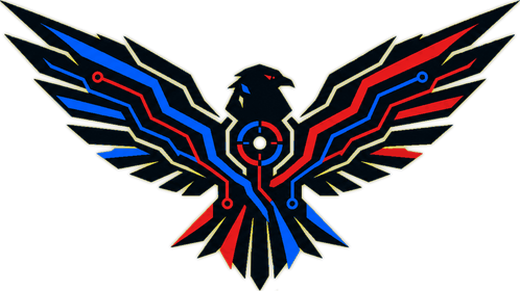
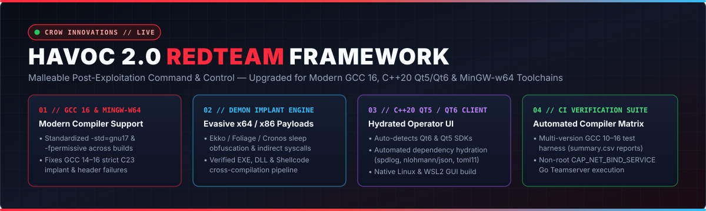
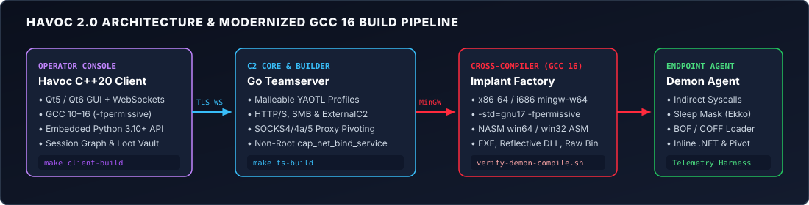

<div align="center">
  <a href="https://CROWinnovations.com">
    
  </a>
  &nbsp;&nbsp;&nbsp;&nbsp;
  

  # HAVOC 2.0 — RedTeam Adversary Simulation & C2 Framework

  **Maintained & Upgraded by:** [CROWinnovations.com](https://CROWinnovations.com) &nbsp;|&nbsp; **Compiler Support:** `GCC 10–16` & `MinGW-w64` &nbsp;|&nbsp; **License:** [GPL-3.0](./LICENSE)
</div>



**HAVOC 2.0** is an upgraded, modern, and malleable post-exploitation Command and Control (C2) and adversary simulation framework maintained by **[CROW Innovations](https://CROWinnovations.com)**. Built for Red Team operations, endpoint telemetry verification, and detection/logging gap analysis, HAVOC 2.0 modernizes the upstream Havoc C2 framework so the **C++20 Qt Operator Client**, **Go Teamserver**, and **Demon Implant (`x64`/`x86` EXE, Reflective DLL, and Raw Shellcode)** compile cleanly out-of-the-box on modern Linux distributions shipping **GCC 13, 14, 15, and 16** and current **MinGW-w64** cross-compilers.

---

## 1. What Was Upgraded in `HAVOC 2.0`



Upstream Havoc fails to compile on recent Debian, Ubuntu, Kali Rolling, and Arch releases due to strict C23/C++20 enforcement in newer GCC (`14`–`16`) and `mingw-w64` toolchains, missing standard integer/time header includes, uninitialized third-party submodules, and deprecated Qt5-only CMake lookups. **HAVOC 2.0** resolves these bottlenecks across the entire stack:

| Subsystem | Files Upgraded | Engineering Upgrades Applied |
| :--- | :--- | :--- |
| **1. GCC 16 & MinGW-w64 Implant Cross-Compiler** | [`teamserver/pkg/common/builder/builder.go`](./teamserver/pkg/common/builder/builder.go), [`payloads/Demon/`](./payloads/Demon), [`payloads/Shellcode/makefile`](./payloads/Shellcode/makefile), [`payloads/DllLdr/makefile`](./payloads/DllLdr/makefile) | Standardized `-std=gnu17 -fpermissive -Os -fno-asynchronous-unwind-tables -masm=intel` across the Teamserver payload builder, Demon implant, Shellcode generator, and Reflective DLL loader—eliminating `[-] Couldn't compile implant: exit status 1` under GCC 14–16. |
| **2. C++20 Qt5 / Qt6 Client Modernization** | [`client/CMakeLists.txt`](./client/CMakeLists.txt), [`client/include/`](./client/include), [`client/src/`](./client/src) | Updated CMake to support both `Qt6` and `Qt5` (`find_package(QT NAMES Qt6 Qt5 ...)`), enforced C++20 with `-fpermissive`, and resolved missing `<cstdint>` / `QTime` incomplete type definitions flagged by modern `g++`. |
| **3. Automated Client Dependency Hydration** | [`scripts/hydrate-client-deps.sh`](./scripts/hydrate-client-deps.sh), [`makefile`](./makefile) | Automatically initializes or clones required header-only C++ dependencies (`spdlog`, `nlohmann/json`, `toml11`) and `client/Modules` prior to invoking CMake. |
| **4. Multi-Compiler Verification & CI Harness** | [`test-gcc-compatibility.sh`](./test-gcc-compatibility.sh), [`scripts/verify-gcc16.sh`](./scripts/verify-gcc16.sh), [`scripts/verify-demon-compile.sh`](./scripts/verify-demon-compile.sh), [`scripts/build-client-wsl.sh`](./scripts/build-client-wsl.sh) | Added standalone verification scripts that test CMake configuration and parallel compilation across installed `gcc-10` through `gcc-16` toolchains (producing `gcc-compatibility-results/summary.csv`) and standalone `x64`/`x86` Demon implant compilation. |
| **5. Non-Root Teamserver Execution & Distro Installer** | [`makefile`](./makefile), [`teamserver/Install.sh`](./teamserver/Install.sh) | Added automated pre-flight checks and non-interactive package installation for `apt-get` (Debian/Ubuntu/Kali) and `pacman` (Arch), embeddable git commit stamps, and `setcap 'cap_net_bind_service=+ep' havoc` so the Teamserver can bind privileged ports without running as `root`. |

---

## 2. Quick-Start Installation & Build

### Prerequisites (Debian / Ubuntu / Kali Rolling)
```bash
sudo apt update && sudo apt install -y \
  git build-essential cmake nasm mingw-w64 golang-go \
  python3-dev qtbase5-dev libqt5websockets5-dev libqt5svg5-dev \
  libfontconfig1 libglu1-mesa-dev libspdlog-dev libboost-all-dev \
  libssl-dev libsqlite3-dev mesa-common-dev
```

### Clone & Build Both Teamserver and Client
```bash
git clone https://github.com/CROWInnovations/HAVOC_2.0.git
cd HAVOC_2.0

# Build both the Go Teamserver (./havoc) and C++ Qt Client (./client/Havoc):
make all

# Or build each component individually:
make ts-build        # Installs/verifies deps and compiles ./havoc Teamserver
make client-build    # Hydrates spdlog/json/toml11 and compiles ./client/Havoc
```

### Run the GCC 16 & Demon Implant Verification Suite
```bash
# End-to-end toolchain, Shellcode, DllLdr, Demon x64/x86, Teamserver, and Client verification:
bash scripts/verify-gcc16.sh

# Test Demon implant compilation directly (x64 or x86):
bash scripts/verify-demon-compile.sh x64
bash scripts/verify-demon-compile.sh x86

# Run multi-compiler matrix test across installed GCC versions (10 through 16):
chmod +x test-gcc-compatibility.sh
./test-gcc-compatibility.sh 11 12 13 14 15 16
```

---

## 3. Running HAVOC 2.0

### Start the Teamserver
```bash
./havoc server --profile ./profiles/havoc.yaotl -v --debug
```

### Start the Operator Client
```bash
./havoc client
# (or launch ./client/Havoc directly; on WSL2 use: bash scripts/build-client-wsl.sh)
```

---

## 4. Core Capabilities & Operator Interface

- **Demon Implant (`payloads/Demon/`)**:
  - Sleep obfuscation techniques (**Ekko**, **Foliage**, **Cronos**) with configurable sleep/jitter and stack spoofing.
  - Indirect `NTDLL` syscalls, AMSI/ETW patching, token vault & impersonation, inline BOF/COFF loader, and inline `.NET` assembly execution.
  - Multi-transport listeners (**HTTP/HTTPS** malleable profiles, **SMB** named-pipe pivoting, and **ExternalC2**).
  - Built-in **SOCKS4 / SOCKS4a / SOCKS5** proxy pivoting and port forwarding.
- **Extensible Operator Console (`client/`)**:
  - Interactive visual Session Graph, multi-operator collaboration, loot & screenshot management, and Python 3.10+ scripting console.

| Operator Console & Session Table | Visual Pivot & Session Graph |
| :---: | :---: |
|  |  |
| **Malleable Listener Configuration** | **Demon Payload Generation (`x64`/`x86`)** |
|  |  |

---

## 5. GPL-3.0 Licensing, Original Creator Credit & Modification Notice

This repository is licensed under the **GNU General Public License v3.0 ([`LICENSE`](./LICENSE))** in full compliance with **GPL-3.0 Section 5** (Conveying Modified Source Versions):

- **Original Creator & Upstream Repository:** Created by **[C5pider](https://github.com/C5pider)** and the **[HavocFramework](https://github.com/HavocFramework/Havoc)** contributors (full upstream acknowledgments in [`CREDITS.md`](./CREDITS.md)).
- **Modifications & Date (`GPL-3.0 Section 5a`):** Modified by **[CROW Innovations](https://CROWinnovations.com)** (`July 2026 – November 2026`) in [`CROWInnovations/HAVOC_2.0`](https://github.com/CROWInnovations/HAVOC_2.0) to add GCC 13–16 and modern `mingw-w64` cross-compilation compatibility, Qt5/Qt6 C++20 CMake support, automated dependency hydration, and GCC 10–16 / Demon compilation verification scripts.
- **Full Operator & Developer Wiki:** [`WIKI.MD`](./WIKI.MD)

> **AUTHORIZED USE DISCLAIMER:** HAVOC 2.0 is provided `"AS IS"` without warranty of any kind (per GPL-3.0 Sections 15–16) strictly for authorized adversary simulation, Red Team engagements, defensive telemetry validation, and security research. Users are solely responsible for obtaining explicit written authorization prior to testing any system or network.
